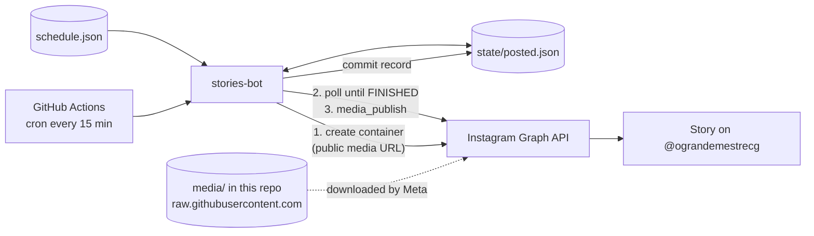

# O Grande Mestre — Instagram Stories Automation

[](https://github.com/pedroalmeidapeixoto/O-Grande-Mestre-Posts/actions/workflows/ci.yml)


🇬🇧 English · [🇧🇷 Português](#-português-br)

A small, production-running bot that publishes **Instagram Stories on a weekly schedule** for my family's restaurant, [@ograndemestrecg](https://www.instagram.com/ograndemestrecg/). It uses the official **Instagram Graph API** and runs entirely on **GitHub Actions**: no server, no paid scheduler, no third-party SaaS.

## Features

- **Schedule as data**: weekdays (recurring) or a calendar date (one-off), local time and media file live in `schedule.json`; changing a post is a commit.
- **Telegram notifications** (optional): a message when a Story goes out or fails, so nobody has to open Actions to check.
- **Send arts through Telegram** (optional): drop the artwork in a private chat with the bot, caption it with when to publish, and it is saved and scheduled for you.
- **Serverless**: GitHub Actions cron triggers the bot every 15 minutes; the repository itself hosts the media.
- **Idempotent**: each Story is published once per day, even if the cron fires late, twice or overlaps.
- **Tolerant to cron jitter**: a slot stays eligible for a configurable window (default 30 min) and still fires correctly across midnight.
- **Never silently lost**: a Story whose window closes without going out is reported once on Telegram (`state/missed.json`), and `stories-tidy` keeps `schedule.json`, `media/` and the state files from growing by dropping one-off Stories 2 days after their date together with their arts (an art another Story still uses is kept).
- **Resilient**: a Story that keeps failing is retried up to 3 times and then given up on with a single alert (`state/attempts.json`); the publish record is pushed with a rebase fallback and the workflow always checks out the branch tip, so a concurrent push or a re-run can never cause a duplicate Story.
- **Safe by design**: credentials come only from environment variables / GitHub Secrets, and error messages never include the request URL, so the token cannot leak into logs.
- **Tested and typed**: 153 tests, `ruff`, strict `mypy`, CI on Python 3.10–3.12.

## How it works



1. The bot loads `schedule.json` and decides which slots are **due now** (inside their window and not yet recorded in `state/posted.json`).
2. For each one it creates a `STORIES` media container pointing to the file's public GitHub URL, waits for Meta to finish processing, then publishes it.
3. The publish record is committed back to the repository so the next run knows what already went out.

### Design decisions

| Decision | Why |
|---|---|
| GitHub as media host (public repo) | The Graph API only accepts a public URL. This removes a whole extra service (S3/Cloudinary) at the cost of a public repo, which is fine for content that is published anyway. |
| Window instead of exact-time match | GitHub cron can be delayed by minutes. A window plus an idempotency key gives at-most-once publishing without a database. |
| State file committed to the repo | Free, auditable persistence; atomic writes avoid half-written files. |
| Credentials required lazily | Dry runs, tests and "nothing due" runs need no secrets, which keeps CI simple and safe. |
| User token + granular scopes for ids | Pages managed by a business portfolio don't show up in `me/accounts`; `stories-token` reads the ids granted to the token instead. |

## Quick start

```bash
git clone https://github.com/pedroalmeidapeixoto/O-Grande-Mestre-Posts.git
cd O-Grande-Mestre-Posts
python -m venv .venv && source .venv/bin/activate   # Windows: .venv\Scripts\Activate.ps1
pip install -e ".[dev]"

pytest                                              # run the test suite
cp schedule.example.json schedule.json              # then edit it
stories-bot --dry-run --now 2026-10-09T18:05        # preview what would be published
```

### Schedule format

```json
{
  "timezone": "America/Sao_Paulo",
  "window_minutes": 30,
  "stories": [
    { "days": ["fri", "sat"], "time": "18:00", "file": "weekend-promo.jpg" },
    { "date": "2026-12-25", "time": "10:00", "file": "christmas-closed.jpg" }
  ]
}
```

Each Story has **either** `days` (recurring, using `mon tue wed thu fri sat sun`) **or** `date` (`YYYY-MM-DD`, published once and then inert). Files live in [`media/`](media/): images are JPG/PNG at 1080×1920, videos MP4/MOV up to 60 s.

`window_minutes` is how long after its time a Story is still published. GitHub's cron can run hours late, so a wide window (up to 720) trades punctuality for never missing a post.

### Notifications (optional)

Create a bot with [@BotFather](https://t.me/BotFather), send it any message, then read your chat id from `https://api.telegram.org/bot<TOKEN>/getUpdates`. Add two more secrets, `TELEGRAM_BOT_TOKEN` and `TELEGRAM_CHAT_ID`. From then on every published Story, failure or setup error sends a short message. Without the secrets nothing changes. A failed notification never fails the run, and logs never contain the bot token.

### Sending arts through Telegram (optional)

With the same two secrets, the bot also **receives** arts. Send the file to the bot as a **file** (paperclip → File, so Telegram does not compress it) and put the time in the caption:

| Caption | Publishes |
|---|---|
| `hoje 18:30` · `18:30` | today at 18:30 |
| `amanhã 12h` | tomorrow at 12:00 |
| `15/11 10:00` · `2026-11-15 10:00` | on that date |
| *(none)* | on the next run, within minutes |

The bot replies to confirm, warns when the image is not 9:16, and answers `/fila` with what is scheduled, each Story with a number. `/cancelar N` removes Story number N (and its art, unless another Story still uses it); numbers follow the position in `schedule.json`, so they stay the same while other Stories are posted or expire. Each run, the `stories-inbox` step polls Telegram (`getUpdates`), saves the art in `media/`, appends a one-off entry to `schedule.json` and commits both **before** publishing, because Meta downloads the media from its public URL. The update offset is kept in `state/telegram.json`.

Security: the bot only obeys the private chat whose id is `TELEGRAM_CHAT_ID`; messages from anyone else (including groups) are ignored without a reply. Telegram keeps unread messages for 24 hours, so runs must not stay silent for longer than that; a trigger more frequent than GitHub's own cron (for example an external scheduler calling `workflow_dispatch`) keeps replies fast. Telegram only lets bots download files up to 20 MB.

## Setup for your own account

1. **Instagram**: a Professional (Business/Creator) account linked to a Facebook Page.
2. **Meta app**: create a Business app at [developers.facebook.com](https://developers.facebook.com), add the use case *Manage messaging & content on Instagram*, and in the [Graph API Explorer](https://developers.facebook.com/tools/explorer) generate a user token with `instagram_basic`, `instagram_content_publish`, `pages_show_list`, `pages_read_engagement`, selecting your Page and Instagram account.
3. **Long-lived token**: run `stories-token` and paste the App ID, App Secret and the short token. It prints the `IG_USER_ID` and a ~60-day `IG_ACCESS_TOKEN`. Nothing is written to disk.
4. **GitHub**: create a **public** repository from this code and add two secrets (*Settings → Secrets and variables → Actions*): `IG_USER_ID` and `IG_ACCESS_TOKEN`.
5. Add artwork to `media/`, fill `schedule.json`, push. The `Publish Stories` workflow does the rest; you can also run it manually from the *Actions* tab.

> **Token renewal:** long-lived tokens expire after ~60 days. Generate a new short token, run `stories-token` again and update the `IG_ACCESS_TOKEN` secret. A failed run shows up as a red workflow and a GitHub email.
>
> **Expiry reminder:** set the repository *variable* `IG_TOKEN_EXPIRES` (Settings → Secrets and variables → Actions → Variables) to the day the token expires, as `YYYY-MM-DD`. Read it from Meta's [Access Token Debugger](https://developers.facebook.com/tools/debug/accesstoken/) (the field *Expires*); it is not always 60 days after issue. With Telegram configured, the bot then warns once a day during the last 10 days, and again if it has already expired. When the Graph API reports an invalid or expired token (codes 102/190), the bot stops at once with a clear message instead of retrying every Story.

## Limitations

- The API cannot add interactive stickers (poll, link, mention). Put any text inside the artwork.
- The repository must be public so Meta can fetch the media.
- GitHub may delay scheduled runs, and it can pause scheduled workflows in repositories with no activity for 60 days; a manual run re-enables them.

## Project layout

```
src/stories_bot/
  schedule.py     parse + validate schedule, decide what is due
  instagram.py    Graph API client (container → poll → publish)
  state.py        atomic record of published Stories
  notify.py       optional Telegram notifications
  telegram.py     Bot API client (token never reaches logs)
  token_expiry.py daily reminder before the Instagram token expires
  tidy.py         `stories-tidy`: drop old one-off Stories, their arts and stale records
  inbox.py        receive arts from Telegram, parse captions, schedule
  inbox_cli.py    `stories-inbox` entry point
  media.py        PNG/JPEG size check for the 9:16 warning
  config.py       environment-based settings, public media URLs
  cli.py          `stories-bot` entry point
  token_setup.py  `stories-token` helper
tests/            pytest suite (HTTP mocked with `responses`)
.github/workflows/
  ci.yml          ruff, mypy, pytest on Python 3.10–3.12
  stories.yml     scheduled publisher
```

## Development

```bash
ruff check . && ruff format --check .   # lint + formatting
mypy                                    # strict type checking
pytest                                  # tests + coverage
```

## License

[MIT](LICENSE) © Pedro Henrique de Almeida Peixoto

---

# 🇧🇷 Português (BR)

Bot que publica **Stories no Instagram em horários semanais** para o restaurante da minha família, o [@ograndemestrecg](https://www.instagram.com/ograndemestrecg/). Usa a **API oficial do Instagram (Graph API)** e roda inteiro no **GitHub Actions**: sem servidor, sem agendador pago, sem SaaS de terceiros.

## Destaques

- **Agenda como dados**: dias da semana (recorrente) ou uma data (avulso), horário local e arquivo ficam em `schedule.json`; mudar um post é um commit.
- **Avisos no Telegram** (opcional): uma mensagem quando um Story sai ou falha, sem precisar abrir o Actions.
- **Envio de artes pelo Telegram** (opcional): mande a arte numa conversa privada com o bot, com o horário na legenda, e ele salva e agenda para você.
- **Serverless**: o cron do GitHub Actions dispara o bot a cada 15 minutos; o próprio repositório hospeda as artes.
- **Idempotente**: cada Story sai uma vez por dia, mesmo que o cron atrase, dispare duas vezes ou se sobreponha.
- **Tolerante a atrasos do cron**: cada horário vale por uma janela configurável (padrão 30 min), inclusive na virada do dia.
- **Seguro por padrão**: credenciais só vêm de variáveis de ambiente / GitHub Secrets, e as mensagens de erro nunca incluem a URL da requisição, então o token não vaza nos logs.
- **Nada se perde em silêncio**: um Story cuja janela fecha sem ter saído é avisado uma vez no Telegram (`state/missed.json`), e o `stories-tidy` impede que `schedule.json`, `media/` e os arquivos de estado cresçam para sempre, removendo os Stories avulsos 2 dias depois da data, junto com as artes (uma arte que outro Story ainda usa é mantida).
- **Resiliente**: um Story que continua falhando é tentado até 3 vezes e depois abandonado com um único alerta (`state/attempts.json`); o registro de publicação é enviado com rebase de reserva e o workflow sempre usa a ponta da branch, então um push simultâneo ou um re-run nunca gera Story duplicado.
- **Testado e tipado**: 153 testes, `ruff`, `mypy` estrito e CI em Python 3.10–3.12.

## Como funciona

1. O bot lê o `schedule.json` e decide quais horários estão **devidos agora** (dentro da janela e ainda não registrados em `state/posted.json`).
2. Para cada um, cria um container `STORIES` apontando para a URL pública do arquivo no GitHub, espera a Meta processar e publica.
3. O registro da publicação é commitado de volta no repositório, para a próxima execução saber o que já foi.

O diagrama e a tabela de decisões de design estão na seção em inglês acima.

## Uso rápido

```bash
git clone https://github.com/pedroalmeidapeixoto/O-Grande-Mestre-Posts.git
cd O-Grande-Mestre-Posts
python -m venv .venv && .venv\Scripts\Activate.ps1
pip install -e ".[dev]"

pytest
copy schedule.example.json schedule.json
stories-bot --dry-run --now 2026-10-09T18:05
```

Cada Story usa **ou** `days` (recorrente, com `mon tue wed thu fri sat sun`) **ou** `date` (`AAAA-MM-DD`, sai uma vez e depois fica inativo). As artes ficam em [`media/`](media/): imagens JPG/PNG 1080×1920, vídeos MP4/MOV de até 60 s.

`window_minutes` é quanto tempo depois do horário o Story ainda pode sair. O cron do GitHub pode atrasar horas, então uma janela larga (até 720) troca pontualidade por nunca perder um post.

### Avisos (opcional)

Crie um bot no [@BotFather](https://t.me/BotFather), mande qualquer mensagem para ele e pegue o seu chat id em `https://api.telegram.org/bot<TOKEN>/getUpdates`. Cadastre mais dois secrets: `TELEGRAM_BOT_TOKEN` e `TELEGRAM_CHAT_ID`. A partir daí, cada Story publicado, falha ou erro de configuração gera uma mensagem curta. Sem os secrets nada muda. Falha no aviso nunca derruba a execução, e os logs nunca mostram o token do bot.

### Enviar artes pelo Telegram (opcional)

Com os mesmos dois secrets, o bot também **recebe** artes. Mande o arquivo ao bot como **arquivo** (clipe → Arquivo, para o Telegram não comprimir) e coloque o horário na legenda:

| Legenda | Publica |
|---|---|
| `hoje 18:30` · `18:30` | hoje às 18:30 |
| `amanhã 12h` | amanhã às 12:00 |
| `15/11 10:00` · `2026-11-15 10:00` | nessa data |
| *(sem legenda)* | na próxima rodada, em poucos minutos |

O bot responde confirmando, avisa se a imagem não for 9:16 e responde ao `/fila` com o que está agendado, cada Story com um número. `/cancelar N` remove o Story de número N (e a arte, a menos que outro Story ainda a use); os números seguem a posição no `schedule.json`, então não mudam enquanto outros Stories saem ou vencem. A cada rodada, o passo `stories-inbox` consulta o Telegram, salva a arte em `media/`, acrescenta uma entrada avulsa no `schedule.json` e commita os dois **antes** de publicar, porque a Meta baixa a mídia pela URL pública. A posição das mensagens lidas fica em `state/telegram.json`.

Segurança: o bot só obedece ao chat privado cujo id está em `TELEGRAM_CHAT_ID`; mensagens de qualquer outra pessoa (inclusive grupos) são ignoradas sem resposta. O Telegram guarda mensagens não lidas por 24 horas, então as execuções não podem ficar mudas por mais que isso; um gatilho mais frequente que o cron do GitHub (por exemplo um agendador externo chamando `workflow_dispatch`) deixa as respostas rápidas. O Telegram só deixa bots baixarem arquivos de até 20 MB.

## Configuração para sua conta

1. **Instagram** profissional (Business/Creator) ligado a uma Página do Facebook.
2. **App na Meta**: crie um app Business em [developers.facebook.com](https://developers.facebook.com), adicione o caso de uso *Gerenciar mensagens e conteúdo no Instagram* e gere, no [Explorador da Graph API](https://developers.facebook.com/tools/explorer), um token com `instagram_basic`, `instagram_content_publish`, `pages_show_list` e `pages_read_engagement`, escolhendo a Página e a conta do Instagram.
3. **Token de longa duração**: rode `stories-token` e informe App ID, App Secret e o token curto. Ele imprime o `IG_USER_ID` e um `IG_ACCESS_TOKEN` de ~60 dias. Nada é gravado em disco.
4. **GitHub**: crie um repositório **público** com este código e cadastre dois secrets (*Settings → Secrets and variables → Actions*): `IG_USER_ID` e `IG_ACCESS_TOKEN`.
5. Coloque as artes em `media/`, preencha o `schedule.json` e faça push. O workflow `Publish Stories` cuida do resto; também dá para rodá-lo manualmente na aba *Actions*.

> **Renovação do token:** tokens de longa duração expiram em ~60 dias. Gere um novo token curto, rode `stories-token` de novo e atualize o secret `IG_ACCESS_TOKEN`.
>
> **Lembrete de vencimento:** cadastre a *variável* de repositório `IG_TOKEN_EXPIRES` (Settings → Secrets and variables → Actions → Variables) com o dia em que o token vence, no formato `AAAA-MM-DD`. Leia na [Ferramenta de Depuração de Token](https://developers.facebook.com/tools/debug/accesstoken/) da Meta (campo *Expira*); nem sempre são 60 dias depois da emissão. Com o Telegram configurado, o bot avisa uma vez por dia nos últimos 10 dias e de novo se já venceu. Quando a Graph API informa token inválido ou vencido (códigos 102/190), o bot para na hora com uma mensagem clara, em vez de tentar cada Story.

## Limitações

- A API não permite stickers interativos (enquete, link, menção): coloque o texto dentro da arte.
- O repositório precisa ser público para a Meta conseguir baixar as mídias.
- O GitHub pode atrasar execuções agendadas e pausar workflows de repositórios sem atividade por 60 dias; uma execução manual reativa.

## Licença

[MIT](LICENSE) © Pedro Henrique de Almeida Peixoto
